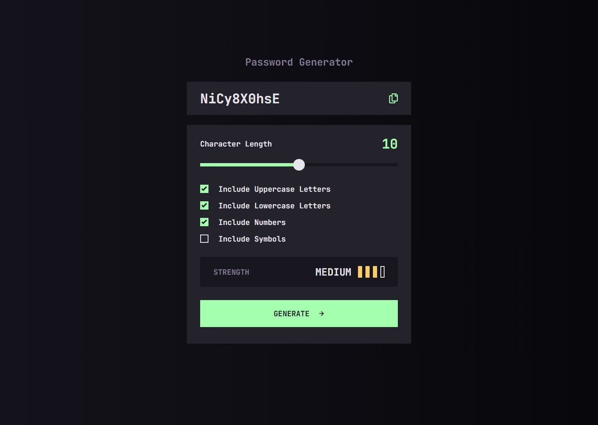

# Frontend Mentor — решение челленджа «Генератор паролей»

Это решение [челленджа «Password generator app» на Frontend Mentor](https://www.frontendmentor.io/challenges/password-generator-app-Mr8CLycqjh). Челленджи Frontend Mentor помогают прокачать навыки программирования на реалистичных проектах.

## Содержание

- [Обзор](#обзор)
  - [Задача](#задача)
  - [Скриншот](#скриншот)
  - [Ссылки](#ссылки)
- [Мой процесс](#мой-процесс)
  - [Стек технологий](#стек-технологий)
  - [Чему я научился](#чему-я-научился)

## Обзор

### Задача

Пользователи должны иметь возможность:

- Генерировать пароль на основе выбранных параметров
- Копировать сгенерированный пароль в буфер обмена
- Видеть оценку надёжности сгенерированного пароля
- Видеть оптимальную раскладку интерфейса в зависимости от размера экрана устройства
- Видеть состояния hover и focus у всех интерактивных элементов на странице

### Скриншот

### Ссылки

- Рабочая версия сайта: [vimanshin.github.io/password-generator-app](https://vimanshin.github.io/password-generator-app)

## Мой процесс

### Стек технологий

### Чему я научился
